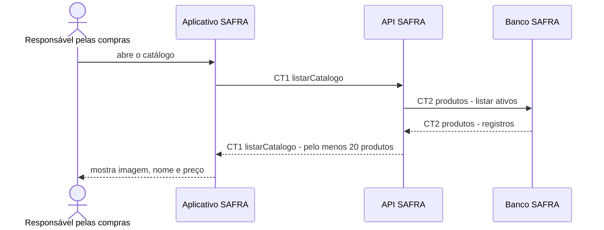

# Fluxo do E1: Catálogo de produtos

**Feito quando (da Entrega 1):** A pessoa abre o catálogo e vê ao menos 20 produtos, cada um com imagem, nome e preço em reais.

## Passos

1. A pessoa responsável pelas compras abre o catálogo no Aplicativo SAFRA.
2. O Aplicativo SAFRA chama a API SAFRA com `CT1 listarCatalogo`.
3. A API SAFRA lê os produtos ativos no Banco SAFRA com `CT2 produtos`.
4. A API SAFRA confirma que o catálogo de demonstração contém pelo menos 20 produtos.
5. A API SAFRA devolve nome, imagem e preço de cada produto.
6. O Aplicativo SAFRA apresenta o catálogo para a pessoa.

## Diagrama

**Contratos usados:** CT1 listarCatalogo, CT2 produtos.
