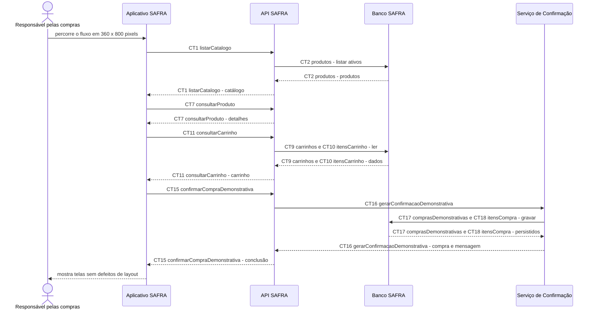

# Fluxo do E10: Interface revisada do fluxo

**Feito quando (da Entrega 1):** A pessoa percorre catálogo, produto, carrinho e confirmação em uma tela de 360 × 800 pixels, sem textos cortados, sobreposição de botões ou rolagem horizontal.

## Passos

1. A pessoa inicia o Aplicativo SAFRA em uma área visível de 360 x 800 pixels.
2. O aplicativo obtém o catálogo por `CT1 listarCatalogo` e apresenta cartões sem rolagem horizontal da página.
3. A pessoa abre um item; o aplicativo usa `CT7 consultarProduto` e mostra os detalhes sem cortes.
4. A pessoa abre o carrinho; o aplicativo usa `CT11 consultarCarrinho` e mantém botões e totais legíveis.
5. A pessoa confirma um carrinho não vazio por `CT15 confirmarCompraDemonstrativa`.
6. A API SAFRA usa `CT16 gerarConfirmacaoDemonstrativa`; o Serviço de Confirmação grava `CT17 comprasDemonstrativas` e `CT18 itensCompra` para concluir o fluxo.
7. O aplicativo mostra a confirmação dentro da área visível, sem sobreposição ou rolagem horizontal.

## Diagrama

**Contratos usados:** CT1 listarCatalogo, CT2 produtos, CT7 consultarProduto, CT9 carrinhos, CT10 itensCarrinho, CT11 consultarCarrinho, CT15 confirmarCompraDemonstrativa, CT16 gerarConfirmacaoDemonstrativa, CT17 comprasDemonstrativas, CT18 itensCompra.
