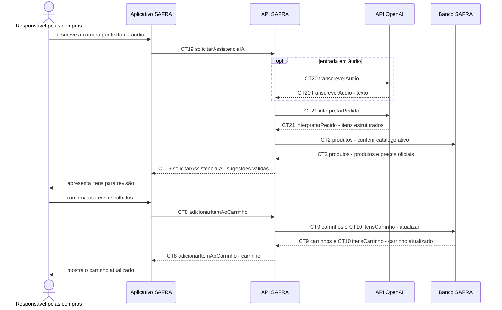

# Fluxo do E11: Assistente de compras com IA

**Feito quando (mudança de escopo confirmada pelo grupo):** A pessoa descreve por texto ou áudio os produtos de que precisa, recebe sugestões que existem no catálogo demonstrativo e pode confirmar quais itens serão adicionados ao carrinho.

## Passos

1. A pessoa abre o assistente no Aplicativo SAFRA e envia um pedido em texto ou grava um áudio.
2. O aplicativo chama `CT19 solicitarAssistenciaIA` sem expor credenciais da OpenAI.
3. Se a entrada for áudio, a API SAFRA solicita a transcrição externa por `CT20 transcreverAudio`.
4. A API SAFRA envia o texto à OpenAI por `CT21 interpretarPedido` e recebe uma lista estruturada de termos e quantidades.
5. A API SAFRA consulta `CT2 produtos`, associa somente itens ativos do catálogo e descarta sugestões sem correspondência.
6. A API devolve as sugestões com os identificadores, nomes e preços oficiais do catálogo.
7. A pessoa revisa e confirma os itens; o aplicativo usa `CT8 adicionarItemAoCarrinho` para cada escolha.
8. A API atualiza `CT9 carrinhos` e `CT10 itensCarrinho`, e o aplicativo mostra o carrinho resultante.

## Diagrama

**Contratos usados:** CT2 produtos, CT8 adicionarItemAoCarrinho, CT9 carrinhos, CT10 itensCarrinho, CT19 solicitarAssistenciaIA, CT20 transcreverAudio, CT21 interpretarPedido.
