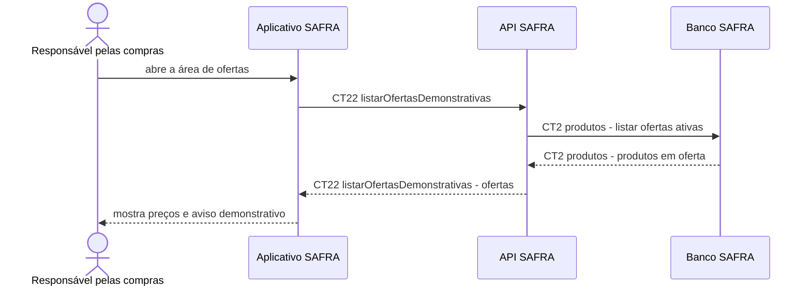

# Fluxo do E12: Ofertas demonstrativas

**Feito quando (mudança de escopo confirmada pelo grupo):** A pessoa abre a área de ofertas e vê somente produtos marcados no catálogo como oferta demonstrativa, com preço atual e preço anterior, sem indicação de consulta em tempo real a mercados.

## Passos

1. A pessoa abre a área de ofertas no Aplicativo SAFRA.
2. O aplicativo chama `CT22 listarOfertasDemonstrativas`.
3. A API SAFRA consulta `CT2 produtos` e seleciona os produtos ativos com `em_oferta` igual a verdadeiro.
4. O banco devolve os produtos e os valores demonstrativos cadastrados.
5. A API converte os nomes do banco para a convenção das mensagens e responde ao aplicativo.
6. O aplicativo mostra preço anterior, preço atual e o aviso "oferta demonstrativa".

## Diagrama

**Contratos usados:** CT2 produtos, CT22 listarOfertasDemonstrativas.
