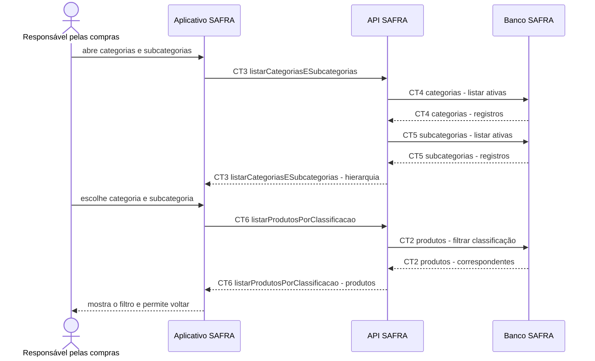

# Fluxo do E2: Navegação por categorias e subcategorias

**Feito quando (da Entrega 1):** A pessoa seleciona uma das 4 categorias e uma subcategoria, vê somente os produtos correspondentes e consegue voltar à listagem anterior.

## Passos

1. A pessoa abre a navegação por classificação no Aplicativo SAFRA.
2. O aplicativo chama `CT3 listarCategoriasESubcategorias`.
3. A API SAFRA lê `CT4 categorias` e `CT5 subcategorias` no Banco SAFRA.
4. A pessoa escolhe uma das quatro categorias e depois uma subcategoria.
5. O aplicativo chama `CT6 listarProdutosPorClassificacao`.
6. A API SAFRA consulta `CT2 produtos` pelos identificadores recebidos.
7. O aplicativo mostra somente os produtos correspondentes.
8. A pessoa usa voltar e o aplicativo retorna à listagem anterior sem perder a classificação selecionada.

## Diagrama

**Contratos usados:** CT2 produtos, CT3 listarCategoriasESubcategorias, CT4 categorias, CT5 subcategorias, CT6 listarProdutosPorClassificacao.
