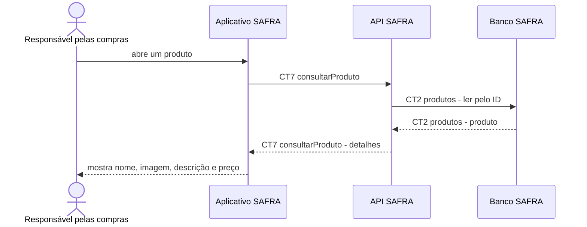

# Fluxo do E3: Detalhes do produto

**Feito quando (da Entrega 1):** A pessoa abre um produto e vê nome, imagem, descrição e preço iguais aos dados desse item no catálogo.

## Passos

1. A pessoa seleciona um produto no Aplicativo SAFRA.
2. O aplicativo chama a API SAFRA com `CT7 consultarProduto`.
3. A API SAFRA consulta o Banco SAFRA com `CT2 produtos`.
4. A API SAFRA devolve os dados atuais do item.
5. O aplicativo apresenta nome, imagem, descrição e preço sem alterar os valores recebidos.

## Diagrama

**Contratos usados:** CT2 produtos, CT7 consultarProduto.
