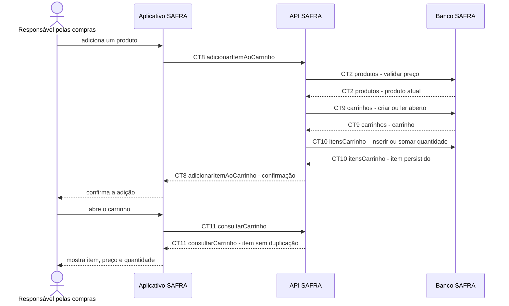

# Fluxo do E4: Adição ao carrinho

**Feito quando (da Entrega 1):** A pessoa adiciona um produto e recebe confirmação; ao abrir o carrinho, encontra o mesmo item com preço e quantidade corretos, sem duplicação indevida.

## Passos

1. A pessoa toca em adicionar na tela do produto.
2. O Aplicativo SAFRA chama `CT8 adicionarItemAoCarrinho` com produto e quantidade.
3. A API SAFRA lê o produto com `CT2 produtos` para validar o preço.
4. A API SAFRA cria ou lê o carrinho em `CT9 carrinhos`.
5. A API SAFRA inclui o item ou aumenta a linha existente em `CT10 itensCarrinho`, sem duplicá-la.
6. A API SAFRA devolve o carrinho atualizado e o aplicativo confirma a adição.
7. Ao abrir o carrinho, o aplicativo chama `CT11 consultarCarrinho` e mostra o mesmo item, preço e quantidade.

## Diagrama

**Contratos usados:** CT2 produtos, CT8 adicionarItemAoCarrinho, CT9 carrinhos, CT10 itensCarrinho, CT11 consultarCarrinho.
