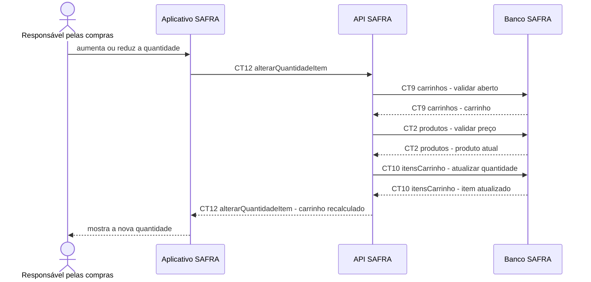

# Fluxo do E5: Controle de quantidades

**Feito quando (da Entrega 1):** A pessoa aumenta ou reduz a quantidade de um item e vê a nova quantidade no carrinho; a aplicação impede quantidade negativa.

## Passos

1. A pessoa escolhe aumentar ou reduzir a quantidade de um item.
2. O Aplicativo SAFRA impede o envio de quantidade menor que 1 e usa remoção explícita para retirar o item.
3. O aplicativo chama `CT12 alterarQuantidadeItem`.
4. A API SAFRA valida o carrinho em `CT9 carrinhos` e o produto em `CT2 produtos`.
5. A API SAFRA atualiza `CT10 itensCarrinho`.
6. A API SAFRA devolve o carrinho recalculado.
7. O aplicativo mostra a nova quantidade.

## Diagrama

**Contratos usados:** CT2 produtos, CT9 carrinhos, CT10 itensCarrinho, CT12 alterarQuantidadeItem.
