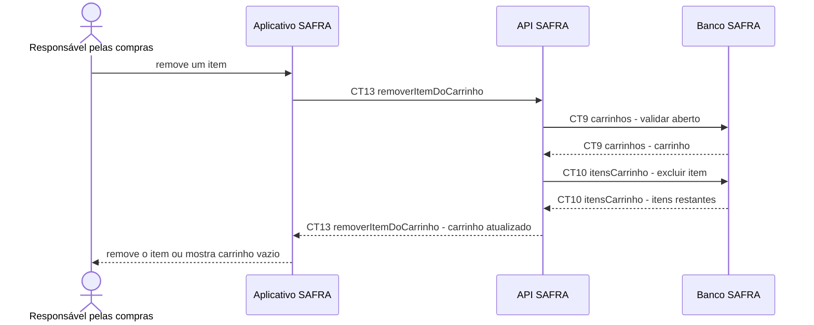

# Fluxo do E6: Remoção de itens

**Feito quando (da Entrega 1):** A pessoa remove um item e ele desaparece do carrinho; ao remover o último, vê uma mensagem de carrinho vazio e uma opção para voltar ao catálogo.

## Passos

1. A pessoa escolhe remover um item do carrinho.
2. O Aplicativo SAFRA chama `CT13 removerItemDoCarrinho`.
3. A API SAFRA valida `CT9 carrinhos` e exclui a linha em `CT10 itensCarrinho`.
4. A API SAFRA devolve o estado completo do carrinho.
5. O aplicativo remove o item da tela.
6. Se não restarem itens, o aplicativo mostra carrinho vazio e a opção de voltar ao catálogo.

## Diagrama

**Contratos usados:** CT9 carrinhos, CT10 itensCarrinho, CT13 removerItemDoCarrinho.
