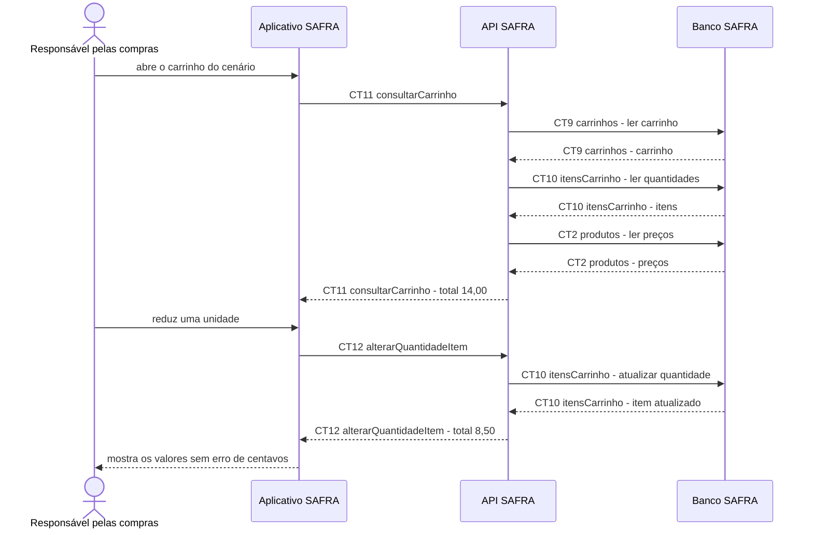

# Fluxo do E7: Subtotal e total da compra

**Feito quando (da Entrega 1):** A pessoa adiciona 2 unidades de R$ 5,50 e 1 de R$ 3,00 e vê R$ 14,00; ao retirar uma unidade do primeiro item, vê R$ 8,50, sem erro de centavos.

## Passos

1. A pessoa abre o carrinho depois de incluir os produtos do cenário.
2. O Aplicativo SAFRA chama `CT11 consultarCarrinho`.
3. A API SAFRA lê `CT9 carrinhos`, `CT10 itensCarrinho` e os preços em `CT2 produtos`.
4. A API SAFRA calcula cada subtotal e o total usando valores decimais, sem ponto flutuante binário.
5. A API SAFRA devolve subtotal de R$ 11,00, subtotal de R$ 3,00 e total de R$ 14,00.
6. A pessoa reduz a quantidade do primeiro item e o aplicativo usa `CT12 alterarQuantidadeItem`.
7. A API SAFRA recalcula e devolve o total de R$ 8,50.

## Diagrama

**Contratos usados:** CT2 produtos, CT9 carrinhos, CT10 itensCarrinho, CT11 consultarCarrinho, CT12 alterarQuantidadeItem.
