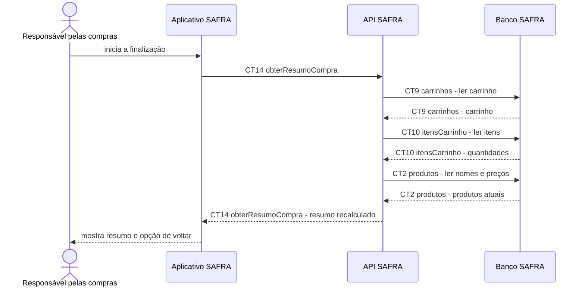

# Fluxo do E8: Resumo da compra

**Feito quando (da Entrega 1):** A pessoa inicia a finalização e vê itens, quantidades, subtotais e total iguais aos do carrinho, com opção de voltar e corrigir a seleção.

## Passos

1. A pessoa toca em finalizar no carrinho.
2. O Aplicativo SAFRA chama `CT14 obterResumoCompra`.
3. A API SAFRA lê `CT9 carrinhos`, `CT10 itensCarrinho` e `CT2 produtos`.
4. A API SAFRA recalcula subtotais e total e devolve o resumo.
5. O Aplicativo SAFRA apresenta itens, quantidades, subtotais e total.
6. A pessoa pode voltar ao carrinho sem confirmar e corrigir a seleção.

## Diagrama

**Contratos usados:** CT2 produtos, CT9 carrinhos, CT10 itensCarrinho, CT14 obterResumoCompra.
