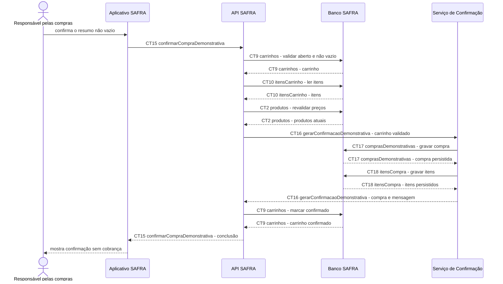

# Fluxo do E9: Confirmação demonstrativa

**Feito quando (da Entrega 1):** A pessoa confirma um carrinho não vazio e vê a mensagem de compra demonstrativa concluída; com carrinho vazio, a aplicação impede a conclusão.

## Passos

1. A pessoa confirma o resumo no Aplicativo SAFRA.
2. O aplicativo bloqueia localmente a ação quando o resumo não contém itens.
3. Para carrinho não vazio, o aplicativo chama `CT15 confirmarCompraDemonstrativa` com chave de idempotência.
4. A API SAFRA relê `CT9 carrinhos`, `CT10 itensCarrinho` e `CT2 produtos` e recalcula o total.
5. A API SAFRA envia ao Serviço de Confirmação os dados validados por `CT16 gerarConfirmacaoDemonstrativa`.
6. O Serviço de Confirmação grava `CT17 comprasDemonstrativas` e `CT18 itensCompra` em uma única transação.
7. O Serviço de Confirmação devolve o identificador da compra e a mensagem demonstrativa; a API marca o carrinho como confirmado por `CT9 carrinhos`.
8. O aplicativo informa que a compra demonstrativa foi concluída e que não houve cobrança.

## Diagrama

**Contratos usados:** CT2 produtos, CT9 carrinhos, CT10 itensCarrinho, CT15 confirmarCompraDemonstrativa, CT16 gerarConfirmacaoDemonstrativa, CT17 comprasDemonstrativas, CT18 itensCompra.
