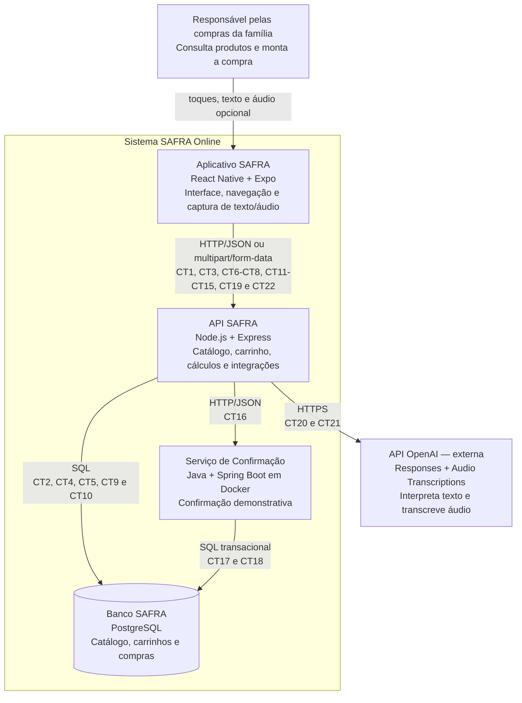

# Visão geral do SAFRA Online

## Identificação e base do escopo

- **Turma:** 218063
- **Grupo:** 01
- **Projeto:** SAFRA Online
- **Referência do OpenProject:** OP#1.0
- **Nome do PDF de entrega:** `ESPECIFICACAO-218063-grupo01.pdf`

Esta especificação usa como base o documento **ESCOPO-01-grupo01**. Os IDs, nomes e critérios de "feito quando" de E1 a E10 foram preservados literalmente. A identificação final da turma foi atualizada para 218063 por confirmação do grupo.

### Mudanças de escopo declaradas

- O carrinho e a compra simulada pertencem ao escopo. Eles já são atendidos pelos entregáveis oficiais E4 a E9 e não criam uma nova numeração.
- O rótulo provisório "E5 — IA" foi substituído por **E11 — Assistente de compras com IA**, porque E5 já é "Controle de quantidades" na Entrega 1.
- O rótulo provisório "E6 — checkout simulado" foi absorvido por E8 e E9, porque E6 já é "Remoção de itens" na Entrega 1.
- Foi acrescentado **E12 — Ofertas demonstrativas**. Não há integração com mercados: as ofertas são dados de demonstração mantidos no catálogo do próprio sistema.
- O escopo termina em uma confirmação demonstrativa de compra, sem cobrança. Pagamento real, entrega e logística continuam fora do escopo.
- O assistente usa a API da OpenAI para interpretar texto e, quando a pessoa optar por áudio, transcrevê-lo. A API SAFRA sempre confere os produtos sugeridos no catálogo local antes de responder.
- O serviço Java exigido pelo professor roda em contêiner Docker e é responsável pela confirmação demonstrativa e pela persistência dessa confirmação. Ele não processa pagamento.
- O catálogo de demonstração contém pelo menos 20 produtos distribuídos em pelo menos 4 categorias.

## Módulos

O primeiro nome informado pelo grupo é o responsável principal. O segundo atua como apoio. Documentação não aparece como contêiner no diagrama porque não é um processo em execução nem um armazenamento de dados.

| Módulo | Tipo | Tecnologia | Responsabilidade | Responsável principal | Apoio |
| --- | --- | --- | --- | --- | --- |
| Aplicativo SAFRA | Próprio | React Native com Expo | Exibir catálogo, ofertas, produto, carrinho, resumo, assistente e confirmação; manter a navegação adequada a 360 x 800 pixels. | João Pedro Rocha | Marcelo Müller |
| API SAFRA | Próprio | Node.js com Express | Definir a API do aplicativo, validar catálogo e carrinho, calcular valores e coordenar Java e OpenAI. | Felipe Gabriel Parra | Alex Hidek Nakamura |
| Serviço de Confirmação | Próprio | Java com Spring Boot em Docker | Gerar e persistir a confirmação demonstrativa e seus itens, sem pagamento real. | Alex Hidek Nakamura | Felipe Gabriel Parra |
| Banco SAFRA | Próprio | PostgreSQL | Guardar categorias, subcategorias, produtos, ofertas demonstrativas, carrinhos, itens e compras demonstrativas. | Felipe Gabriel Parra | Alex Hidek Nakamura |
| API OpenAI | Externo | Responses API e Audio Transcriptions API | Transcrever áudio opcional e interpretar o pedido em uma resposta estruturada. | OpenAI | — |

**Responsabilidade transversal:** João Vitor Peternella responde pela documentação e pelos diagramas e apoia o frontend. João Pedro Rocha e Marcelo Müller respondem em conjunto pelo design e frontend; Felipe Gabriel Parra e Alex Hidek Nakamura respondem em conjunto pelo backend e Docker.

## Diagrama de contêineres — C4 nível 2

## Convenção de nomes e tipos

Nas mensagens entre módulos usamos `camelCase` (`produtoId`, `precoUnitario`, `atualizadoEm`). No banco usamos `snake_case` (`produto_id`, `preco_unitario`, `atualizado_em`). Nome de operação é verbo no infinitivo mais o objeto (`consultarProduto`, `alterarQuantidadeItem`). Nome de mensagem de aviso é o objeto mais o que aconteceu. Tabelas ficam no plural e em `snake_case` (`produtos`, `itens_carrinho`). Identificadores terminam em `Id` nas mensagens e em `_id` no banco. APIs preservam nomes em português; não usamos o nome legado `categorys` nos novos contratos.

Os contratos usam os tipos neutros `texto`, `inteiro`, `decimal`, `booleano`, `data-hora`, `arquivo`, `objeto`, `lista de <tipo>` e `um de: <valores>`. Valores monetários são decimais em reais com duas casas, sem o prefixo `R$`. Datas com hora usam ISO 8601 em UTC. Identificadores textuais usam UUID. Campos opcionais aparecem como `não` na coluna Obrigatório e não são enviados como texto vazio.

## Regras que atravessam os módulos

1. A API SAFRA é a fonte dos preços, subtotais e total; o frontend apenas exibe os valores recebidos.
2. O mesmo produto aparece uma única vez no carrinho. Nova adição aumenta sua quantidade.
3. A quantidade de um item é sempre um inteiro entre 1 e 99; zero é tratado como remoção explícita.
4. Carrinho vazio não pode ser confirmado.
5. A confirmação é demonstrativa e informa claramente que não houve cobrança.
6. A chave de idempotência impede que a mesma confirmação seja registrada duas vezes.
7. O catálogo usado no teste possui pelo menos 20 produtos em pelo menos 4 categorias.
8. Uma oferta é demonstrativa, vem do banco local e não representa preço em tempo real de nenhum mercado.
9. A IA nunca cria preço nem produto: a API cruza as sugestões com CT2 antes de responder e exige confirmação da pessoa antes de adicionar qualquer item.
10. A chave da OpenAI fica somente no backend e nunca é enviada ao aplicativo.

## Índice de entregáveis e contratos

| Entregável | Fluxo | Contratos |
| --- | --- | --- |
| E1 Catálogo de produtos | [E1-catalogo-de-produtos.md](E1-catalogo-de-produtos.md) | CT1, CT2 |
| E2 Navegação por categorias e subcategorias | [E2-navegacao-por-categorias-e-subcategorias.md](E2-navegacao-por-categorias-e-subcategorias.md) | CT2, CT3, CT4, CT5, CT6 |
| E3 Detalhes do produto | [E3-detalhes-do-produto.md](E3-detalhes-do-produto.md) | CT2, CT7 |
| E4 Adição ao carrinho | [E4-adicao-ao-carrinho.md](E4-adicao-ao-carrinho.md) | CT2, CT8, CT9, CT10, CT11 |
| E5 Controle de quantidades | [E5-controle-de-quantidades.md](E5-controle-de-quantidades.md) | CT2, CT9, CT10, CT12 |
| E6 Remoção de itens | [E6-remocao-de-itens.md](E6-remocao-de-itens.md) | CT9, CT10, CT13 |
| E7 Subtotal e total da compra | [E7-subtotal-e-total-da-compra.md](E7-subtotal-e-total-da-compra.md) | CT2, CT9, CT10, CT11 |
| E8 Resumo da compra | [E8-resumo-da-compra.md](E8-resumo-da-compra.md) | CT2, CT9, CT10, CT14 |
| E9 Confirmação demonstrativa | [E9-confirmacao-demonstrativa.md](E9-confirmacao-demonstrativa.md) | CT2, CT9, CT10, CT15, CT16, CT17, CT18 |
| E10 Interface revisada do fluxo | [E10-interface-revisada-do-fluxo.md](E10-interface-revisada-do-fluxo.md) | CT1, CT2, CT7, CT9, CT10, CT11, CT15, CT16, CT17, CT18 |
| E11 Assistente de compras com IA | [E11-assistente-de-compras-com-ia.md](E11-assistente-de-compras-com-ia.md) | CT2, CT8, CT9, CT10, CT19, CT20, CT21 |
| E12 Ofertas demonstrativas | [E12-ofertas-demonstrativas.md](E12-ofertas-demonstrativas.md) | CT2, CT22 |
